# BudgetSplit architecture

**Execution model:** hybrid. A thin Expo (React Native) client on each member's phone, and one
cloud API that owns every rule about money. PostgreSQL is the only place the ledger lives.

**Style:** modular monolith (one deployable API, one module per domain area), layered inside each
module: HTTP routes → service (business rules) → Prisma → Postgres. See [ADR 0001](adr/0001-modular-monolith.md).

## Component diagram

Thick arrows are the walking-skeleton path built in Milestone 2. Dashed nodes are planned, with their story.

```mermaid
flowchart TB
  subgraph phone["Member's phone · Expo / React Native"]
    GV["Group view<br/>US-03 · US-05"]
    AC["API client<br/>typed · retry-safe"]
    SI["Sign-in<br/>US-01 (planned)"]
  end

  subgraph api["Render web service (Docker) · Node 22 + Express"]
    HTTP["HTTP layer<br/>zod validation · auth · group-membership check · errors"]
    subgraph modules["Domain modules"]
      GR["Groups<br/>members, join order"]
      EX["Expenses<br/>even split in cents"]
      BA["Balances<br/>net per member"]
      ST["Settlement<br/>US-06 (planned)"]
      AI["AI insights<br/>US-11 (planned)"]
      RE["Reminders<br/>US-08 (planned)"]
    end
    DA["Data access<br/>Prisma ORM 7 · pg adapter"]
  end

  PG[("Render Postgres 17<br/>users · groups · group_members · expenses · expense_shares")]
  FB["Firebase Auth<br/>US-01 (planned)"]
  LLM["Hosted LLM API<br/>aliases + totals only"]
  PUSH["Expo Push → FCM / APNs"]
  CRON["Render cron job<br/>same image · US-10"]

  GV ==> AC ==>|HTTPS · JSON| HTTP ==> EX ==> BA ==> DA ==>|SQL, private network| PG
  HTTP --> GR
  HTTP -.-> ST
  SI -.->|sign in| FB
  HTTP -.->|verify ID token| FB
  AI -.-> LLM
  RE -.-> PUSH
  CRON -.-> PG

  classDef planned stroke-dasharray: 5 4,color:#666;
  class SI,ST,AI,RE,FB,LLM,PUSH,CRON planned;
```

## Request path of the walking skeleton (US-03)

1. **Group view** validates the draft (`validateDraft`) and keeps one `Idempotency-Key` per draft.
2. **API client** sends `POST /groups/:groupId/expenses` with `X-User-Id` (dev auth) and the key.
3. **HTTP layer** authenticates the user (`devAuth`), checks group membership (`requireGroupMember`) and validates the body with zod.
4. **Expenses** loads members in join order, splits in integer cents (`splitEven`), and writes the expense and its shares in one transaction. A repeated key returns the original expense.
5. **Balances** sums paid and owed per member with two `groupBy` queries and checks that the group nets to $0.00.
6. The response carries the expense and fresh balances, so the screen redraws in one round trip.

## Data model

| Table | Key columns | Rules enforced by the database |
| --- | --- | --- |
| `users` | `id`, `display_name`, `auth_uid` (Firebase, US-01) | unique email and auth uid |
| `groups` | `id`, `name` | — |
| `group_members` | (`group_id`, `user_id`), `role`, `joined_at` | composite primary key |
| `expenses` | `id`, `group_id`, `paid_by_id`, `created_by_id`, `amount_cents`, `idempotency_key` | payer and creator must be members of the same group (composite foreign keys); `0 < amount_cents <= 1,000,000`; unique (`group_id`, `idempotency_key`) |
| `expense_shares` | (`expense_id`, `user_id`), `share_cents` | `share_cents >= 0` |

## Quality attributes (Ch. 4, Table 4.2)

Ranked: reliability, security, usability, maintainability (high); resilience, responsiveness (medium);
availability (low). The full justification and the trade-offs (T1–T4) are in the Milestone 2 document.

| Attribute | Where it shows up in the code |
| --- | --- |
| Reliability | `split.ts` (integer cents), `compute.ts` (sum-to-zero check), transaction + idempotency in `expenses.service.ts`, CHECK constraints in the migration |
| Security | `http/auth.ts` (authentication seam + membership check), `config.ts` (refuses dev auth in production unless explicitly allowed), zod strict bodies |
| Usability | one-screen add-expense, even split by default, inline errors (`expenseDraft.ts`) |
| Maintainability | `packages/shared` contract, one module per domain area, CI on every PR |
| Resilience | external calls will sit behind adapters with timeouts (US-08, US-11); the ledger never depends on them |
| Responsiveness | expense response includes fresh balances (one round trip); `requestLog.ts` records latency per request |
| Availability | `/health` endpoint for Render health checks; graceful SIGTERM shutdown in `server.ts` |
