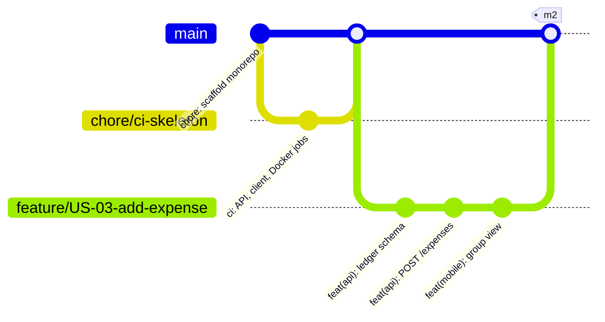

# Git branching workflow

We use **GitHub Flow**: `main` is always deployable, and every change reaches it through a short-lived
branch and a reviewed pull request. Render deploys `main` automatically once CI passes.

## Rules

1. **Branch from `main`** and name it after the story: `feature/US-04-custom-splits`, `fix/US-03-rounding`,
   `chore/ci-cache`, `docs/m3-report`. One story per branch; keep it under about 3 days of work.
2. **Commit messages** follow Conventional Commits and end with the story id:
   `feat(expenses): reject payers outside the group [US-03]`.
3. **Open a pull request early** (draft is fine). Fill in the template and link the issue with `Closes #12`.
4. **Merge only when** all three CI jobs are green and one teammate approved. Use **Squash and merge** so
   `main` gets one commit per story, then delete the branch.
5. **Never push directly to `main`** and never force-push it.
6. **Tag each milestone** on `main` (`m2`, `m3`, …) so the submitted version can always be checked out.
7. **Rolling back:** revert the squash commit with `git revert <sha>` and merge that PR; Render can also roll
   back to a previous deploy from its dashboard in one click.

## Protecting `main` on GitHub

Settings → Branches → Add rule for `main`: require a pull request with 1 approval, require the status checks
`API · typecheck, migrate, test, build`, `Shared + mobile · typecheck, test, bundle` and `Docker · API image builds`,
and block force pushes. Branch protection is free for public repositories; private repositories need a paid or
education plan on the organization.

## Who reviews what

Any teammate can review any PR. A PR that changes `apps/api/prisma/` (the schema) or `packages/shared/`
(the API contract) needs a second look from someone who works on the other side (API vs. mobile).
