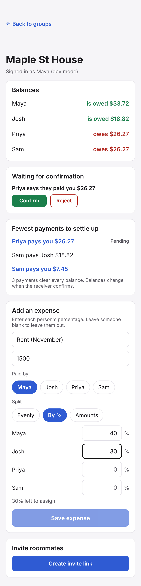
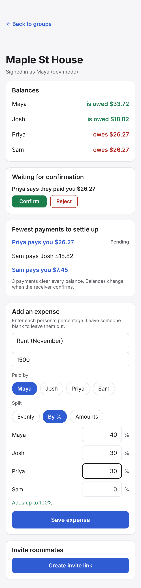
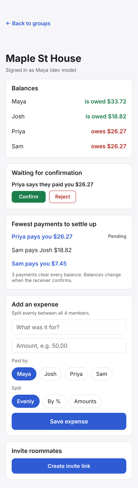
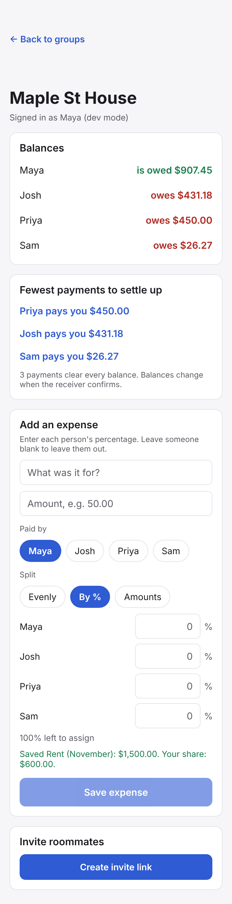
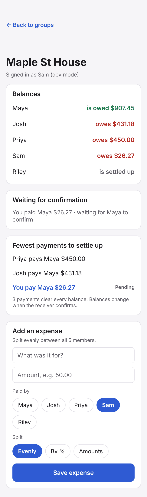
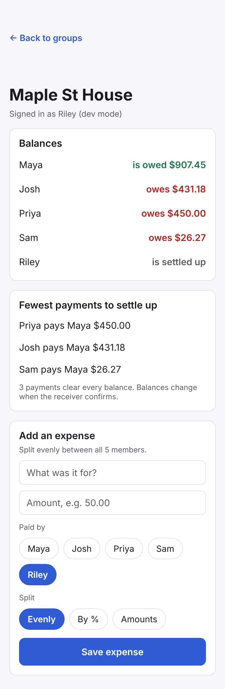
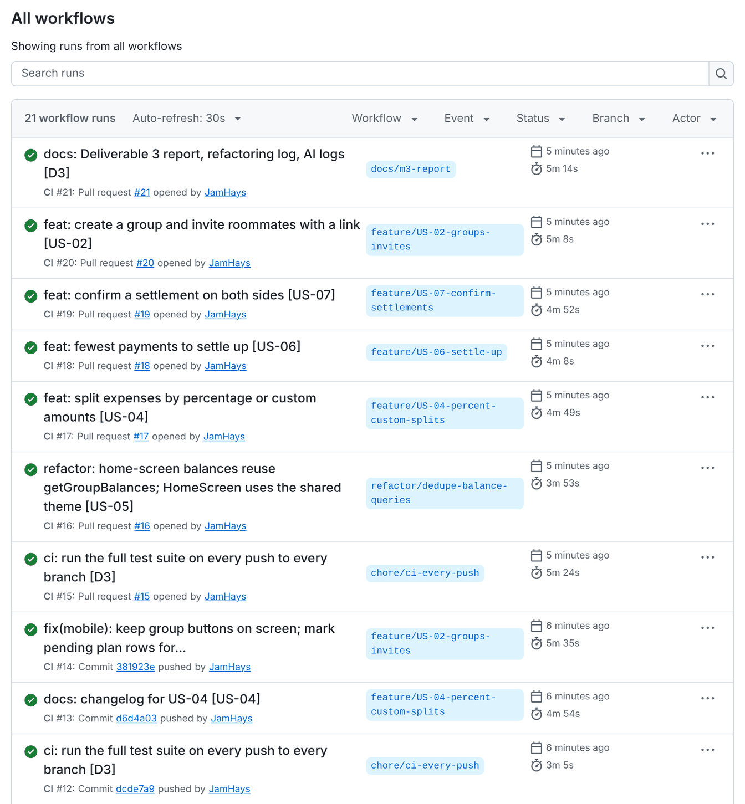

# BudgetSplit · Deliverable 3: MVP core features, built incrementally with testing

**Team:** Rick Daniel, Samuel Mendoza, James Hays · **Date:** November 3, 2026
**Repo:** `no-ad-technologies/BudgetSplit` · Copy kept in the repo so it is versioned with the code.

## Summary

| Requirement | Evidence | Where |
| --- | --- | --- |
| Core features as a series of increments | 4 MVP stories (US-02, US-04, US-06, US-07) on 7 stacked branches, 27 commits, each story built shared types → API → tests → mobile → changelog | §1, `git log --graph` |
| Unit tests + equivalence-partitioning table | `splitByPercent`: 20 partitions (V1–V10, I1–I10) with boundaries; `splitExact`: 4. 27 tests named after the rows | §2, [docs/testing/equivalence-partitioning.md](testing/equivalence-partitioning.md) |
| Feature / integration tests (Ch. 9) | 6 files, 77 tests, through the real Express app and a real PostgreSQL test database, one file per user flow | §3 |
| Refactoring log, ≥ 2 examples (Ch. 8) | 4 entries with before/after code: long method, component doing too much, duplicated code + deep nesting, duplicated code | §4, [docs/refactoring-log.md](refactoring-log.md) |
| CI runs the full suite on every push (Ch. 10) | Trigger changed from "push to `main`" to every push on every branch + PRs + manual; all 14 runs green after pushing (7 push, 7 PR); badge in README | §5 |
| AI as pair programmer | Where it sped us up; 8 bugs or bad suggestions caught | §6, [docs/ai/m3-pair-programming-log.md](ai/m3-pair-programming-log.md) |
| AI-generated tests vs a seeded bug | Primary seeded bug **missed** by the AI tests, caught by ours; 9-bug sample: AI 7/9, ours 9/9 | §7, [docs/ai/m3-ai-generated-tests.md](ai/m3-ai-generated-tests.md) |

**Tests: 222, all passing** (API 155, mobile 24, shared 43), up from 68 at Milestone 2.

## 1 · Core features, one increment at a time

Each branch builds on the one before it and follows `docs/branching.md` (one story per branch,
Conventional Commits ending in the story id). The suite was green at the end of every story.

| Order | Branch | Commits | What it adds |
| --- | --- | --- | --- |
| 1 | `chore/ci-every-push` | 1 | CI on every push, status badge |
| 2 | `refactor/dedupe-balance-queries` | 3 | Tests for the untested home-screen endpoint, then refactors #3 and #4 |
| 3 | `feature/US-04-percent-custom-splits` | 8 | Split functions → AI-generated tests → partition table + tests → seeded-bug run → shared types → API → mobile form → changelog |
| 4 | `feature/US-06-settle-up` | 4 | Exact planner → API → mobile card → changelog |
| 5 | `feature/US-07-confirm-settlements` | 4 | Settlements table + balance formula → record/confirm/reject API → mobile → changelog |
| 6 | `feature/US-02-groups-invites` | 5 | Invites table → create/invite/join/revoke API → mobile → changelog → UI fixes from screenshots |
| 7 | `docs/m3-report` | 2 | This report, refactoring log, AI logs, screenshots, README and architecture updates; CI evidence |

Each branch has its own pull request, #15 to #21, in the order above. Each PR targets the branch before it, so
its diff shows only that increment.

### Acceptance criteria and how each is checked

| Story | Criterion | Checked by |
| --- | --- | --- |
| **US-04** Percent / custom splits | Custom amounts must add up; Save disabled and difference shown until they do | `expenseDraft.test.ts` ("$0.01 left to assign", "$0.50 over the total"); API returns 400 "Custom amounts add up to $89.99, not $90.00" (`splits.api.test.ts` E2) |
| | Percentages must add up to 100%; leftover cents in join order | `split.percent.test.ts` V5–V8, I9–I10; `splits.api.test.ts` V6, I9 |
| | A member can be left out at $0.00 | `splits.api.test.ts` V4 (Sam at $0.00 on rent), E1 |
| **US-06** Fewest payments | True minimum for ≤ 12 members; ≤ n − 1 above | `settlePlan.test.ts`: brute-force cross-check on 300 groups, a case where greedy needs 5 and exact 4, the > 12 fallback |
| | Every suggested payment brings every balance to $0.00 | 1,000-case property test; end to end through the API in `settlements.api.test.ts` |
| | Payer, receiver, exact amount; updates after changes | `settleUp.api.test.ts` |
| **US-07** Confirm on both sides | "Josh paid Maya $42.50" is Pending for both; balances unchanged | `settlements.api.test.ts` |
| | Balances change only when Maya confirms; she can reject with a reason | same file, plus 403 for anyone else and 409 for a second confirm or a race |
| | Audit record: who recorded, who confirmed, when, how much | stored-row assertions + 5 database CHECK constraints tested with raw inserts |
| **US-02** Groups and invites | Creator is first member and admin | `groups.api.test.ts` |
| | Roommate opens the link, joins, sees the same balances | same file; screenshot 9 |
| | Link expires after 7 days; admin can revoke sooner | same file, plus a database CHECK that no invite outlives 7 days |

### Screens (rendered at phone width, 390 pt)

| | |
| --- | --- |
|  |  |
| US-04: Save stays disabled while 30% is unassigned | US-04: Adds up to 100%, Save enabled |
|  |  |
| US-06 + US-07: Maya can confirm Priya's payment | After confirming and saving rent: three payments clear the group |
|  |  |
| US-07: Sam recorded his payment; it waits for Maya | US-02: Riley joined from Maya's invite and starts settled up |

## 2 · Unit tests and equivalence partitioning

**Function:** `splitByPercent(amountCents, allocations)`. It decides who pays how many cents when an
expense is split by percentage. Percentages are integer basis points (1% = 100). Leftover cents go, in
join order, only to members whose exact share has a fraction of a cent, so every share is within one cent
of its exact value and a 0% member always pays $0.00.

| ID | Class | Valid? | Representative input | Expected |
| --- | --- | --- | --- | --- |
| V1 | Amount at its boundaries | ✓ | 1 cent at 100%; 1,000,000 at 25/75 | `[1]`; `[250000, 750000]` |
| V2 | One member at 100% | ✓ | 4510 at 100% | `[4510]` |
| V3 | Several members totaling 100% | ✓ | 120,000 at 40/30/20/10 | `[48000, 36000, 24000, 12000]` |
| V4 | No leftover | ✓ | 150,000 at 40/30/30 | `[60000, 45000, 45000]` |
| V5 | Leftover > 0, given in join order to members with a fraction | ✓ | 2 at 33.33/33.33/33.34 | `[1, 1, 0]` |
| V6 | 0% member first in join order, leftover > 0 | ✓ | 999 at 0/50/50 | `[0, 500, 499]` |
| V7 | Whole exact share first in join order, leftover > 0 | ✓ | 1005 at 20/30/50 | `[201, 302, 502]` |
| V8 | Non-zero percentage worth under one cent | ✓ | 100 at 0.01/99.99 | `[1, 99]` |
| V9 | Output order and ids | ✓ | sam 25%, maya 75% | `["sam", "maya"]` |
| V10 | Property over the valid space | ✓ | 2,000 seeded-random splits | total = amount; each share floor or ceil of exact |
| I1 | Amount ≤ 0 | ✗ | 0, −1 | `RangeError` |
| I2 | Amount > max | ✗ | 1,000,001 | `RangeError` |
| I3 | Amount not an integer | ✗ | 12.5, NaN, ∞ | `RangeError` |
| I4 | No members | ✗ | `[]` | `RangeError` |
| I5 | Duplicate member | ✗ | maya twice | `RangeError` |
| I6 | Negative percentage, only rule broken | ✗ | −1 / 5000 / 5001 | `RangeError` |
| I7 | Percentage > 100% | ✗ | 10,001 | `RangeError` (can't be isolated, see table doc) |
| I8 | Fractional basis point | ✗ | 3333.5 / 3333.5 / 3333 | `RangeError` |
| I9 | Total 99.99% | ✗ | 5000 + 4999 | `RangeError` |
| I10 | Total 100.01% | ✗ | 5000 + 5001 | `RangeError` |

V6–V8 are the partitions that matter most: they are on the **output** side (who gets the leftover cent),
so you don't find them by partitioning the inputs alone. The companion table for `splitExact` (E1–E4)
and the note on I6/I7 are in the full document.

Other new unit tests: `settlePlan.test.ts` (11, including brute-force and property tests),
`compute.test.ts` (settlements in balances), and mobile logic tests for drafts, settle-up wording and
invite parsing.

## 3 · Feature and integration tests (Ch. 9)

Every test below runs the real Express app (`createApp`) against the real Prisma client and a PostgreSQL
test database that is emptied before each test. They refuse to run against a database without `test` in
its name.

| User flow | File | Tests | Highlights |
| --- | --- | --- | --- |
| Add an even expense, see balances (M2) | `expenses.api.test.ts` | 22 | auth, validation, idempotent retries, 5-request race, DB constraints |
| Home screen: my groups and my net | `userGroups.api.test.ts` | 5 | written before refactor #3 to pin behavior |
| Split by percentage or custom amounts | `splits.api.test.ts` | 14 | rent at 40/30/30 with a member left out; readable 400s; 422 for outsiders; replayed retries |
| Fewest payments to settle up | `settleUp.api.test.ts` | 5 | exact plan with names; plan updates after an expense |
| Record and confirm a payment | `settlements.api.test.ts` | 17 | pending changes nothing; confirm moves both balances; double confirm and race → 409; paying every suggestion zeroes the group |
| Create a group, invite, join, revoke | `groups.api.test.ts` | 14 | token stored only as a hash; expiry and revoke → 410; 3 × 6 concurrent joins add the member once; member cap |

**Each concurrency test was checked by breaking the code.** Removing `status: "PENDING"` from the
confirm update fails the double-confirm and race tests. Removing the row lock from `acceptInvite` fails
the join race test (an earlier two-request version passed even without the lock, so we rewrote it; see §6).

## 4 · Refactoring log (Ch. 8)

| # | Smell removed | Change |
| --- | --- | --- |
| 1 | Long method | `createEvenExpense` → `findReplay` + `resolveShares` (PR #12) |
| 2 | Component doing too much | 240-line `GroupScreen` with 11 `useState`s → `useGroupData` + `BalanceList` + `ExpenseForm`; screen is 71 lines (PR #12) |
| 3 | Duplicated code + deep nesting | home-screen route copied the balance queries three callbacks deep → reuses `getGroupBalances` (D3) |
| 4 | Duplicated code | `HomeScreen` had its own palette and color ternary → shared `theme.ts` + `netColor` (D3) |

**Example: #3, duplicated code and deep nesting.** Before, `userGroups.routes.ts`:

```ts
router.get("/groups", async (_req, res) => {
  const memberships = await db.groupMember.findMany({ /* ... */ });
  const summaries = await Promise.all(
    memberships.map(async (membership) => {
      const [members, paid, shares] = await Promise.all([ /* the same 3 queries as balances.service.ts */ ]);
      const paidByUser = new Map(/* ... */);
      const shareByUser = new Map(/* ... */);
      const balances = computeBalances(/* ... */);
      /* ... */
    }),
  );
  res.json({ groups: summaries });
});
```

After:

```ts
router.get("/groups", async (_req, res) => {
  res.json({ groups: await listMyGroupSummaries(db, res.locals.user.id) });
});
// userGroups.service.ts: each group's balances come from getGroupBalances, the one balance query.
```

Five tests were written first and passed before and after. It paid off one story later: US-07 changed
the balance formula to include confirmed settlements in one place, and the home screen got it for free.
With the copy still there, the home screen would have shown the wrong balance after every settlement.

**Example: #2, a component doing too much.** Before, one screen held fetching, retry, refresh,
validation, saving and the layout of both the list and the form:

```tsx
export function GroupScreen() {
  const [group, setGroup] = useState<GroupDto | null>(null);
  const [balances, setBalances] = useState<BalancesDto | null>(null);
  const [loadError, setLoadError] = useState<string | null>(null);
  const [refreshing, setRefreshing] = useState(false);
  const [description, setDescription] = useState("");
  const [amountText, setAmountText] = useState("");
  const [paidById, setPaidById] = useState(DEV_USER_ID);
  const [saving, setSaving] = useState(false);
  const [fieldError, setFieldError] = useState<FieldError | null>(null);
  const [saveError, setSaveError] = useState<string | null>(null);
  const [lastSaved, setLastSaved] = useState<string | null>(null);
  // ... load, onRefresh, onSave and ~150 lines of JSX for both parts
}
```

After, the screen only lays out parts that own their own state:

```tsx
const { group, balances, settleUp, pending, /* ... */ onBalancesChanged } = useGroupData(activeGroupId);
return (
  <ScrollView /* ... */>
    <BalanceList balances={balances.balances} />
    <PendingSettlementsCard /* US-07 */ />
    <SettleUpCard /* US-06 */ />
    <ExpenseForm /* US-03, US-04 */ />
    {me?.role === "ADMIN" && <InviteCard /* US-02 */ />}
  </ScrollView>
);
```

That split is why D3 could add three new cards without touching the form. Full before/after code for
all four entries is in [docs/refactoring-log.md](refactoring-log.md).

## 5 · CI runs the full suite on every push (Ch. 10)

```diff
 on:
-  pull_request:
-  push:
-    branches: [main]
+  # Every push, on every branch: a feature branch is tested before anyone opens a PR.
+  push:
+  pull_request:
+  workflow_dispatch:
 concurrency:
   group: ci-${{ github.ref }}
-  cancel-in-progress: true
+  cancel-in-progress: ${{ github.ref != 'refs/heads/main' }}
```

- **Full suite:** the API job applies migrations to a throwaway Postgres 17 and runs all 155 API unit and
  integration tests; the client job runs the shared (43) and mobile (24) tests and bundles the app with
  Metro; the Docker job builds the production image.
- **Never cancelled on `main`:** on Oct 16 two quick merges left `main` with a cancelled run. Now every
  `main` commit gets its own green or red result.
- **Visibly green:** CI badge at the top of the README, plus the Actions tab.

**Evidence, Nov 3:** pushing the 7 D3 branches started 7 `push` runs, one per branch, before any PR existed. That
is the new trigger working. Opening PRs #15–#21 added 7 `pull_request` runs. **All 14 runs passed**, every one with
all three jobs green, including the Docker image build
([final branch's run](https://github.com/no-ad-technologies/BudgetSplit/actions/runs/41689331049): API job 57 s,
client job 47 s, Docker job 139 s).



## 6 · AI component part 1: AI as pair programmer

We used Claude (Claude Opus 5.5) as a pair programmer on every D3 feature.

**Where it sped us up**
- **US-06 exact settle-up.** The subset dynamic program from ADR 0006, an independent brute-force
  checker, and a random search that found a case where greedy isn't minimal ($7, −$6, $1, −$5, −$7, $10:
  greedy 5 payments, exact 4). It's now a regression test.
- **Per-story boilerplate.** Prisma models, migrations with CHECK constraints, zod schemas and supertest
  suites, all in the repo's existing patterns.
- **The seeded-bug harness** and **phone-width screenshots** of every new screen without a phone.

**Bugs and bad suggestions we caught** (all in the AI's own first drafts)

| # | The AI's draft | Caught by |
| --- | --- | --- |
| 1 | A test assertion that compared a value with itself (could never fail), with a wrong comment about the balances | review |
| 2 | `POST /groups` mounted so the route could never match (404 every time) | review |
| 3 | A join-race test that passed even with the lock deleted | deleting the lock on purpose |
| 4 | `SERIALIZABLE` isolation, which would turn the race into errors needing retries | design review → row lock |
| 5 | A negative-percentage test that broke two rules, hiding a missing check | seeded bug S8 |
| 6–7 | Buttons off-screen at 390 pt; a pending payment shown as still owed | screenshots |
| 8 | Metro cache keeping an old environment variable | screenshot showed the wrong user |

**Lesson:** a green test only counts once you've seen it fail. Entries 3 and 5 were tests that were
green but proved nothing.

## 7 · AI component part 2: AI-generated tests vs a seeded bug

The LLM wrote 22 tests for `splitByPercent` from its source code, **before** our partition table existed
and before any bug was chosen. All 22 passed on the correct code.

**Seeded bug (S1):** the leftover cent goes to the first member with any non-zero percentage, even if
their exact share is already whole. On $10.05 split 20 / 30 / 50%, the first member pays $2.02 instead of
$2.01.

- **Did the AI tests catch it? No: 22 of 22 still passed.**
- Our partition tests caught it twice: **V7** (whole exact share first in join order) and the **V10**
  property test.
- The AI tests even had a "within one cent of exact" assertion that would have failed, but they only
  ever tried one set of percentages, which never produces that case. The check was right; the inputs
  never reached it.

**Wider sample** (re-run with `npm run test:seeded-bugs -w @budgetsplit/api`):

| Bug | AI-generated | Hand-designed |
| --- | --- | --- |
| **S1** Leftover cent to a whole exact share | **missed** | caught |
| S2 Leftover cents in join order, 0% included | caught | caught |
| S3 Leftover cents from the last member | caught | caught |
| S4 `Math.round` instead of `Math.floor` | caught | caught |
| S5 Total tolerates ±0.01% | caught | caught |
| S6 $10,000.00 itself rejected | caught | caught |
| S7 Fractional basis points accepted | caught | caught |
| S8 Negative percentages accepted | **missed** | caught (after fixing I6) |
| S9 Duplicate members accepted | caught | caught |
| **Total** | **7 / 9** | **9 / 9** |

**Partitions the AI missed compared with ours:** V7 (whole exact share with a leftover), V8 (a
percentage worth under one cent receiving a cent), I6 in isolation (its negative test also broke the
over-100% rule), and a broad V10 property test (it used one allocation). It covered input boundaries
well: 0, −1, 1,000,001, NaN, ∞, and totals of 99.99% and 100.01%.

**Our own tests had the same blind spot at first:** S8 got past both suites in the first run because our
I6 test also broke two rules. The seeded bug found a flaw in our tests, not just the AI's. We fixed I6
and left the AI file unchanged, since it's what's being evaluated.

## 8 · Not done yet and known limits

- **US-01 sign-in** is still the dev stub (`X-User-Id`, ADR 0004). It needs the team's Firebase project.
- **Invite links** are real `budgetsplit://join/<token>` links and the scheme is registered in `app.json`,
  but the app doesn't open them automatically yet: roommates paste the link or code into "Join a group".
- **Mobile screens** have their logic unit-tested and were checked by rendering them at phone width; there
  are no component-rendering tests.
