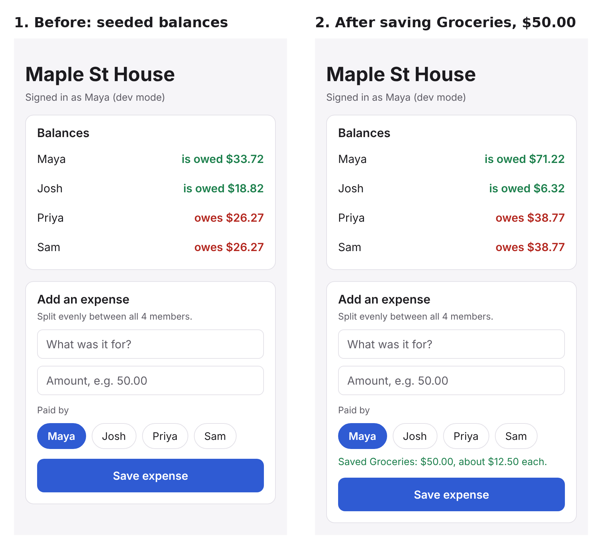

# Walking skeleton (Milestone 2)

**Feature:** add an expense, split it evenly, and see every member's updated balance (US-03, core of US-05).

**Path through the real architecture:** Expo group screen → API client (`fetch`, `X-User-Id`, `Idempotency-Key`)
→ Express HTTP layer (dev auth, membership check, zod validation) → Expenses module (`splitEven`, one transaction)
→ Prisma ORM 7 → PostgreSQL → Balances module (sum-to-zero check) → JSON response → screen redraw.

## Evidence

Screens rendered from the same React Native code with Expo's web target (`npx expo export --platform web`),
talking to the real API and Postgres. Maya's balance moves from "is owed $33.72" to "is owed $71.22" (+$37.50),
and Josh, Priya and Sam each move by -$12.50, exactly as US-03's first acceptance criterion requires.

Automated checks (run locally 2026-10-13, and on every PR in CI):

| Suite | Tests | What it proves |
| --- | --- | --- |
| `packages/shared` | 23 | Formatting and parsing money never uses floats; "12.345" and "-5" are rejected |
| `apps/mobile` | 7 | The form turns "$50" into 5000 cents and flags bad input on the right field |
| `apps/api` unit | 16 | Even split always sums to the amount, differs by at most 1 cent, leftover cents go in join order; balances sum to 0; config refuses dev auth in production |
| `apps/api` integration | 22 | Real HTTP + Postgres: 401/403/400/422 paths, $50.00 split, $10.01 leftover cent, 6 validation cases save nothing, retries and 5 racing requests create exactly one expense, DB constraints block bad rows |

Also verified: the API Docker image builds, applies migrations on start, serves requests as the unprivileged `node`
user and shuts down cleanly on SIGTERM; the app bundles with Metro for Android.

## Run it yourself

See the Quick start in the [README](../README.md). The demo ids are in `packages/shared/src/demo.ts`.

## What is deliberately stubbed

| Stub | Replaced by |
| --- | --- |
| `X-User-Id` header auth (`apps/api/src/http/auth.ts`) | Firebase ID-token verification, US-01 |
| One hard-coded demo group in the app (`apps/mobile/src/config.ts`) | Group list and invites, US-02 |
| Even split only | Custom and percentage splits, US-04 |
| Single screen, no navigation | Expo Router when there are several screens, US-02 |
